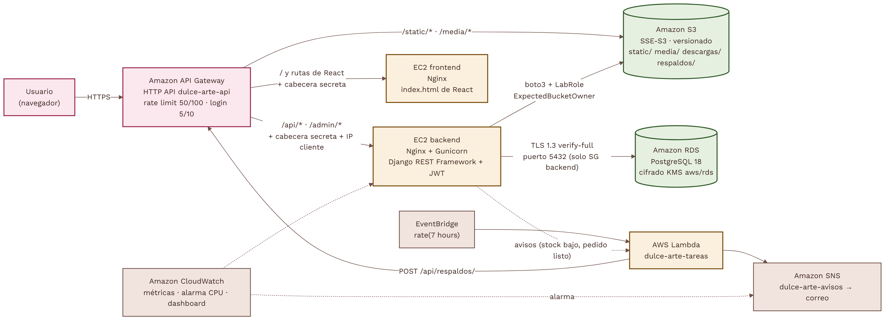

# Dulce Arte en AWS — arquitectura distribuida

Sistema de Trazabilidad y Pedidos para Pastelería Artesanal · INACAP · Bastian Sandoval

El proyecto de la EVA3 (un solo servidor con Django) se separa en servicios de AWS. Cumple la rúbrica de la
**EVA 4 – Programación Backend** (arquitectura AWS, integración y seguridad).



- **Aplicación:** https://kh6uimo2ob.execute-api.us-east-1.amazonaws.com (única entrada, por la API Gateway)
- **Documentación de la API (Swagger):** `/api/docs/`

| Carpeta | Qué contiene | Dónde corre |
|---|---|---|
| `backend/` | Django + Django REST Framework (solo API JSON y Django Admin) | EC2 `dulce-arte-backend` |
| `frontend/` | React (Vite): todas las pantallas por rol | EC2 `dulce-arte-frontend` |
| `lambda/` | Función `dulce-arte-tareas`: respaldo cada 7 horas y avisos por correo (SNS) | AWS Lambda (sin servidor) |
| `scripts/` | Scripts de evidencia (PowerShell): API con JWT y CRUD, y demostración del rate limit | Computador del estudiante |
| `monitoreo/` | Definición del dashboard de CloudWatch | CloudWatch |
| `docs/` | Diagrama de arquitectura | — |

## Etapas

1. **RDS** PostgreSQL privada (`dulce-arte-db`), datos migrados con `pg_dump`/`pg_restore`. ✅
2. **S3** bucket con `media/` y `static/` públicos de lectura y `respaldos/` privado. ✅
3. **EC2 backend**: Django como API pura con login JWT. ✅
4. **EC2 frontend**: React con las mismas pantallas y diseño, servido por Nginx. ✅
5. **API Gateway**: une todo bajo una sola dirección HTTPS, con cabecera secreta hacia las EC2. ✅
6. **Lambda + SNS + EventBridge**: respaldo cada 7 horas y avisos por correo. ✅
7. **Seguridad**: rate limit en dos capas, cifrado de RDS y S3, contraseñas con Argon2, SAST (SonarQube) y DAST (OWASP ZAP). ✅
8. **Operación**: alarma y dashboard de CloudWatch, respaldos automáticos y snapshot manual de RDS. ✅

## Endpoints del backend ↔ pantallas del frontend

Autenticación (JWT):

| Método | Endpoint | Uso |
|---|---|---|
| POST | `/api/auth/token/` | Login: usuario + contraseña → `access`, `refresh` y datos del usuario con su rol |
| POST | `/api/auth/token/refresh/` | Renueva el `access` (dura 30 min; el `refresh`, 8 h) |
| GET | `/api/auth/yo/` | Usuario conectado |
| POST | `/api/auth/admin/` | Vuelve a pedir la contraseña y abre el Django Admin (sesión de 10 min) |
| GET | `/api/salud/` | Backend vivo y conectado a RDS |
| POST | `/api/respaldos/` | Respaldo de la base de datos a S3 (lo pide la Lambda con la cabecera `X-Token-Respaldo`) |

Pantallas (una petición por pantalla de React):

| Ruta en React | Endpoint | Roles |
|---|---|---|
| `/ingresar` | `POST /api/auth/token/` | todos |
| `/` Inicio | `GET /api/pantallas/inicio/` | todos (cada rol recibe su inicio) |
| `/pedidos` | `GET /api/pantallas/pedidos/?estado=&q=&pagina=` | Ventas, Cocina, Admin |
| `/pedidos/:id` | `GET /api/pedidos/:id/` (+ `disponibilidad/`, `confirmar/`, `imagen-referencia/`, `pdf/`) | Ventas, Cocina, Admin |
| `/catalogo` | `GET /api/pantallas/catalogo/?categoria=` | Ventas |
| `/pedidos/nuevo` | `GET /api/pantallas/cotizador/` + `POST /api/clientes/` + `POST /api/pedidos/` | Ventas |
| `/cocina` (Kanban) | `GET /api/pedidos/kanban/` + `POST /api/pedidos/:id/avanzar/` y `rechazar-calidad/` | Cocina (Admin mira) |
| `/cocina/manana` | `GET /api/pantallas/produccion-manana/` | Cocina, Admin |
| `/bodega` | `GET /api/pantallas/bodega/?stock=bajo` + `POST /api/movimientos-insumo/` | Bodega (Admin mira) |
| `/bodega/movimientos` | `GET /api/pantallas/movimientos/?tipo=&periodo=&pagina=` | Bodega, Admin |
| `/despachos` (Mi ruta) | `GET /api/pantallas/despachos/?dia=` + `/api/rutas/` y `/api/despachos/` | Repartidor |
| `/despachos/:id/entregar` | `GET /api/pantallas/despachos/:id/` + `POST /api/despachos/:id/confirmar-entrega/` | Repartidor |
| `/despachos/entregados` | `GET /api/pantallas/entregados/?periodo=` | Repartidor, Admin |
| Botón "Administración" | `POST /api/auth/admin/` y luego `/admin/` (Django Admin) | Admin |

La documentación completa (Swagger) está en `/api/docs/`.

## API Gateway (HTTP API `dulce-arte-api`)

| Ruta | Integración | Mapeo de parámetros |
|---|---|---|
| `ANY /api/{proxy+}` y `POST /api/auth/{proxy+}` | HTTP → `http://<IP backend>` | `overwrite:path = $request.path`, `append:header.X-Origen-Gateway = <secreto>`, `overwrite:header.X-Ip-Cliente = $context.identity.sourceIp` |
| `ANY /admin` y `ANY /admin/{proxy+}` | HTTP → `http://<IP backend>` | igual que la anterior |
| `GET /media/{proxy+}` y `GET /static/{proxy+}` | HTTP → `https://<bucket>.s3.amazonaws.com` | `overwrite:path = $request.path` |
| `$default` (todo lo demás) | HTTP → `http://<IP frontend>` | `overwrite:path = $request.path`, `append:header.X-Origen-Gateway = <secreto>` |

- La API Gateway entrega HTTPS; las EC2 reciben HTTP en el puerto 80.
- La cabecera secreta `X-Origen-Gateway` hace que el backend (Django) y el frontend (Nginx) rechacen con 403
  a quien intente entrar directo a sus IP. El secreto vive solo en la API Gateway y en los servidores, nunca en GitHub.
- `overwrite:path` envía la ruta original completa (con su barra final) a cada servidor.

## Rate limit (dos capas)

| Capa | Límite | Qué protege |
|---|---|---|
| API Gateway, toda la etapa `$default` | 50 peticiones/s, ráfaga de 100 | Que un exceso de tráfico llegue a las EC2 y a RDS |
| API Gateway, ruta `POST /api/auth/{proxy+}` | 5 peticiones/s, ráfaga de 10 | El inicio de sesión |
| Django (DRF), inicio de sesión | 10 intentos/min por IP | Fuerza bruta de contraseñas |
| Django (DRF), contraseña del Admin | 5 intentos/min por usuario | Fuerza bruta del acceso al Admin |
| Django (DRF), resto de la API | 60/min sin sesión (por IP) · 600/min por usuario | Abuso de un mismo cliente |

Quien supera un límite recibe **429 Too Many Requests**. La API Gateway limita el total de tráfico;
Django limita a cada cliente por separado: la API Gateway le entrega la IP real en la cabecera
`X-Ip-Cliente` (mapeo `overwrite:header.X-Ip-Cliente = $context.identity.sourceIp` en las integraciones del backend).

**Demostración:** `scripts/demo_rate_limit.ps1` envía 40 intentos de login simultáneos y clasifica cada respuesta
(401 llegó a Django, 429 de la API Gateway o 429 de Django). Para la prueba se bajó temporalmente la ruta de login
a 1 petición/s y ráfaga 1; luego se restauró a 5/10.

```powershell
powershell -ExecutionPolicy Bypass -File scripts\demo_rate_limit.ps1
```

Se eligió **HTTP API** (y no REST API) porque solo se necesita un proxy HTTPS con límite por ruta: es más simple
y más barata. No incluye AWS WAF ni límites por cliente (API keys), que serían la mejora para producción.

## Contenido estático en S3

| Carpeta del bucket | Contenido | Acceso |
|---|---|---|
| `media/` | Fotos de productos e insumos, firmas, comprobantes de entrega | Público de lectura (por la API Gateway) |
| `static/app/` | JS, CSS e imágenes de React (los sube `frontend/deploy/publicar.sh`) | Público de lectura |
| `static/fuentes/` | Tipografías Fraunces, Work Sans y Playfair Display | Público de lectura |
| `static/admin/`, `static/rest_framework/`… | CSS y JS del Django Admin y de Swagger | Público de lectura |
| `descargas/pedidos/` | Comprobantes de pedido en PDF (`GET /api/pedidos/<id>/pdf/`) | **Privado**: se descarga por la API con JWT |
| `respaldos/` | Respaldos de la base de datos | **Privado** |

La EC2 del frontend solo entrega `index.html`; todo lo demás lo entrega S3 a través de la API Gateway.

## Contraseñas (hash con Argon2)

`PASSWORD_HASHERS` en `backend/config/settings.py` usa **Argon2id** primero (`argon2-cffi`); PBKDF2 queda en la lista
para verificar y convertir hashes antiguos al iniciar sesión. Django guarda `algoritmo$parámetros$salt$hash`, nunca la contraseña.

```bash
venv/bin/python manage.py demostrar_hash                    # dos hash distintos de la misma contraseña (salt)
venv/bin/python manage.py demostrar_hash --usuario cocina1  # cómo está guardado un usuario real en RDS
```

## Cifrado

| Dónde | En reposo (guardado) | En tránsito (viajando) |
|---|---|---|
| **RDS** | AWS KMS, AES-256 (clave `aws/rds`): datos, respaldos automáticos y snapshots | TLS obligatorio: `rds.force_ssl = 1` en RDS y `sslmode=verify-full` en Django con el certificado de AWS |
| **S3** | SSE-S3, AES-256 (clave administrada por S3), en todos los objetos: fotos, firmas, CSS, fuentes y respaldos | Solo HTTPS: la política del bucket rechaza conexiones sin TLS (`aws:SecureTransport`) |
| **Navegador ↔ API Gateway** | — | HTTPS (TLS 1.2 o superior) |
| **Lambda** | Variables de entorno cifradas con AWS KMS | HTTPS hacia la API Gateway y SNS |

`backend/deploy/verificar_cifrado.py` muestra si la conexión Django → RDS va cifrada y con qué algoritmo.

## Desarrollo seguro: SAST y DAST

| Tipo | Herramienta | Qué revisa | Cuándo |
|---|---|---|---|
| SAST (código) | **SonarQube Cloud** | Seguridad, confiabilidad y mantenibilidad (Python, React, shell) | Cada `git push` (`.sonarcloud.properties`) |
| SAST (código) | **Bandit** | Código Python inseguro | Cada `git push` (`.github/workflows/sast.yml`) |
| SAST (código) | **Semgrep** | Reglas de seguridad de Django y React | Cada `git push` |
| SCA (dependencias) | **pip-audit** / **npm audit** | Librerías con vulnerabilidades conocidas (CVE) | Cada `git push` |
| DAST (app funcionando) | **OWASP ZAP** baseline | Cabeceras, cookies, información expuesta, por la API Gateway | A mano y cada lunes (`.github/workflows/dast.yml`) |

Hallazgos corregidos:
- `npm audit` encontró vulnerabilidades altas en `react-router-dom 7.9.1` (redirecciones abiertas, XSS) y `vite 7.1.5` (lectura de archivos del servidor de desarrollo): se actualizaron a 7.18.6 y 7.3.8.
- Bandit marcó `random` en `cargar_demo` (solo datos de demostración, no criptografía): revisado y marcado `# nosec B311`.
- Cabeceras de seguridad en Nginx (`frontend/deploy/cabeceras_seguridad.conf`): HSTS, CSP, X-Frame-Options, X-Content-Type-Options, Referrer-Policy y Permissions-Policy; versión de Nginx oculta.

Resultado del primer DAST (OWASP ZAP, 20-11): 0 alertas altas, 2 medias, 3 bajas y alertas informativas.
- **Media, CSP con `style-src 'unsafe-inline'`:** se quitó. React aplica sus estilos con JavaScript (CSSOM), que la CSP no bloquea.
- **Media, falta Sub Resource Integrity en Google Fonts:** las tipografías ahora están en **S3** (`static/fuentes/`), servidas por la API Gateway. La CSP queda en `font-src 'self'` y `style-src 'self'`.
- **Bajas, COOP y CORP:** se agregaron `Cross-Origin-Opener-Policy` y `Cross-Origin-Resource-Policy`.
- **Baja, COEP:** no se agrega `require-corp`, porque bloquearía el mapa de Google Maps (riesgo aceptado).
- **Informativas** (caché, cabeceras Sec-Fetch de la petición, "aplicación web moderna"): no son vulnerabilidades.
- Segundo informe: aparecieron 4 bajas en los archivos de S3 (`/static/fuentes/`), porque S3 no envía cabeceras de seguridad. Se corrigió con un mapeo de **respuesta** (código 200) en las integraciones de S3 de la API Gateway: `Strict-Transport-Security`, `X-Content-Type-Options`, `Cross-Origin-Resource-Policy` y se elimina `Server`.

| Informe de ZAP | Altas | Medias | Bajas | Informativas |
|---|---|---|---|---|
| 1.º (antes de corregir) | 0 | 2 | 3 | 8 |
| 2.º (fuentes en S3, CSP estricta, COOP y CORP) | 0 | 0 | 5 | 9 |
| 3.º (cabeceras en las respuestas de S3) | 0 | 0 | 1 (COEP, justificada) | 9 |

SonarQube Cloud (primer análisis): 31 issues — Security E, Reliability C, Maintainability A.
Se corrigieron 30 (contraseña escrita en un comando, redirección abierta, `ExpectedBucketOwner` en S3, `--ignore-scripts`
en npm, `--only-binary` en pip, `curl --proto =https`, timeout en la Lambda, promesas sin `.catch`, `autoFocus`) y se
aceptó 1 con justificación (tokens JWT validados antes de guardarlos en `localStorage`). Resultado: **Quality Gate Passed**,
nota A en las tres calidades.

Otras prácticas: secretos solo en `.env` (fuera de GitHub), JWT y permisos por rol en cada endpoint, ORM de Django (evita inyección SQL), React escapa el HTML (evita XSS), CSRF en el Admin, rate limit, grupos de seguridad mínimos y cabecera secreta de la API Gateway.

## Monitoreo (CloudWatch)

- Alarma `dulce-arte-backend-cpu-alta`: CPU promedio de la EC2 backend > 70 % durante 5 minutos → correo por SNS (`dulce-arte-avisos`), también al volver a la normalidad.
- Dashboard `dulce-arte`: se crea pegando `monitoreo/dashboard_cloudwatch.json` en *Acciones → Ver o editar el origen*. Muestra la alarma, CPU de las EC2, peticiones y errores de la API Gateway, latencia, RDS y Lambda.
- Logs de la Lambda en `/aws/lambda/dulce-arte-tareas`.

## Respaldos y recuperación

| Mecanismo | Frecuencia | Recuperación |
|---|---|---|
| Respaldos automáticos de RDS | Diario (ventana 06:00 UTC), retención 7 días | Restaurar a cualquier momento dentro de los 7 días |
| Snapshot manual `dulce-arte-db-eva4-manual` | A pedido | Restaurar ese estado; se conserva hasta borrarlo |
| Respaldo propio (EventBridge `rate(7 hours)` → Lambda → `POST /api/respaldos/`) | Cada 7 horas, se conservan 24 | `manage.py loaddata` del `.json.gz` de `s3://…/respaldos/automaticos/` |

RDS no permite respaldos nativos cada 7 horas: esa frecuencia la da EventBridge + Lambda, aparte del sistema de RDS.

## Evidencias de la API

`scripts/evidencia_api.ps1` prueba por la API Gateway: salud, 401 sin token, login JWT (muestra el payload), 401 con token
falso, 403 por rol, y el CRUD completo de `/api/rutas/` (POST 201, GET 200, PATCH 200, DELETE 204, GET 404). Hace una
pausa antes de borrar para comprobar en la EC2 que el registro está en RDS.

```powershell
powershell -ExecutionPolicy Bypass -File scripts\evidencia_api.ps1
```

## Pruebas

```bash
cd backend
python manage.py test --settings=config.test_settings
```
